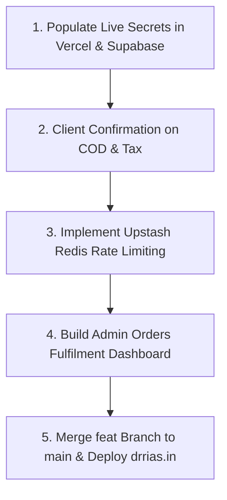

# 📋 Dr Ria's E-Commerce Platform — Comprehensive Project Status Audit

**Audit Date**: November 6, 2026  
**Repository**: `Pratyaksh1507/DrRia-sWebsite`  
**Current Branch**: `feat/admin-dashboard-supabase` (HEAD: `62f0e58`)  
**Production Remote**: `origin/main` (`f9b569c`)  
**Supabase Reference**: `xhjkczndewkocqwsebry` (AWS Tokyo `ap-northeast-1`, Owned by Dr. Ria)  
**Live Deployed Preview**: `https://drriauppal.vercel.app`  

---

## 1. Git Status & History

- **Current Branch**: `feat/admin-dashboard-supabase` [VERIFIED]
- **Uncommitted Files**: `0` (working tree clean) [VERIFIED]
- **Divergence from `origin/main`**: Ahead by 5 commits, behind by 0 commits [VERIFIED]
- **Remote Tracking**: In sync with `origin/feat/admin-dashboard-supabase` at `62f0e58` [VERIFIED]

### Last 15 Commits on Working Branch

| Hash | Date | Subject | Author / Context |
| :--- | :--- | :--- | :--- |
| `62f0e58` | 2026-11-06 | security(admin): enforce recent MFA step-up authentication on product mutations | Step-up recent MFA guard on POST, PATCH, DELETE [VERIFIED] |
| `2f6d93d` | 2026-11-06 | security(auth): enforce HMAC-SHA256 signing and user/session binding on admin cookies | Cryptographic signing of admin cookies with ADMIN_COOKIE_SECRET [VERIFIED] |
| `78d25b8` | 2026-11-05 | fix(auth): add 503 config pre-flight check, site-url helper, and admin recovery guide | Pre-flight check, site-url helper, docs/ADMIN-RECOVERY.md [VERIFIED] |
| `c9b7597` | 2026-11-05 | feat: integrate secure admin dashboard and dynamic product catalogue | Complete Phase 1 & 2 integration and route structure [VERIFIED] |
| `e594fb9` | 2026-11-04 | Paid transition only from pending; status immutability tests | Phase 0.5 atomic paid transition [VERIFIED] |
| `f9b569c` | 2026-11-04 | Update footer with contact icons and Instagram, update product prices to new MRPs, and update customer care email | HEAD of `origin/main` (production deployment) [VERIFIED] |
| `660be58` | 2026-11-03 | Optimize image loading, caching headers, and font weights for Vercel | Vercel performance optimization [VERIFIED] |
| `032ec0c` | 2026-11-03 | Fix EBADPLATFORM by removing @next/swc-darwin-arm64 from direct dependencies | Turbopack multi-platform build fix [VERIFIED] |
| `2e58ef1` | 2026-11-03 | Update footer credit link, remove phone icon from navbar, and add user icon button with tooltip & menu | Navigation enhancements [VERIFIED] |
| `3b64d39` | 2026-11-03 | Update footer logo to transparent version without cream badge background | Brand design update [VERIFIED] |
| `61ecd44` | 2026-11-03 | Update footer logo badge, App Router icons, and web manifest | Favicon and PWA manifest assets [VERIFIED] |
| `a5a4cac` | 2026-11-03 | Update confirmed product catalog prices in data/products.ts | Static catalog pricing sync [VERIFIED] |
| `e60c690` | 2026-11-03 | Update lip balm photo to compact jar with 480/768/1200 WebP/AVIF and remove old spa scene files | Media asset pipeline [VERIFIED] |
| `5233044` | 2026-11-03 | Update login methods, guest session cart, server-synced user carts, and client handover docs | Customer cart sync & documentation [VERIFIED] |
| `a67573d` | 2026-11-03 | Enhance hero section image clarity: full-bleed composition, razor-sharp typography, and responsive WebP/AVIF | Hero visual fidelity [VERIFIED] |

---

## 2. Feature & Phase Audit Matrix

> **Testing Classification Criteria**:
> - **IMPLEMENTED AND TESTED**: Code exists AND an automated test calls the real implementation helper/engine or runs against live PostgreSQL.
> - **IMPLEMENTED, NOT TESTED**: Code exists, but automated tests only run against mock simulators or static SQL regex, not against the live API/database runtime.
> - **PARTIAL**: Part of the feature exists (e.g. database schema or backend logic), but frontend or external integration is incomplete.
> - **NOT STARTED**: No operational code exists in the repository.

### Phase 0 / 0.5: Checkout Security, Webhooks & Data Integrity

| Feature | Status | Evidence File Path(s) | Automated Tests Covering It | Verification Note |
| :--- | :--- | :--- | :--- | :--- |
| **Payment Verify Fails Closed** | **IMPLEMENTED AND TESTED** | [`lib/payment-verify.ts`](file:///Users/pratyakshkalsi/Desktop/drria/lib/payment-verify.ts)<br>[`app/api/orders/verify/route.ts`](file:///Users/pratyakshkalsi/Desktop/drria/app/api/orders/verify/route.ts) | 3 unit tests in `tests/security.test.mjs` (Suite 2) | Calls real helper `checkGatewaySecretConfig()`. Returns 503 fail-closed in production if secret is missing or contains 'placeholder'. [VERIFIED] |
| **Amount, Currency & Captured Check** | **IMPLEMENTED AND TESTED** | [`lib/payment-verify.ts`](file:///Users/pratyakshkalsi/Desktop/drria/lib/payment-verify.ts) | 4 unit tests in `tests/security.test.mjs` (Suite 5) | Calls real helper `verifyPaymentCapturedAndAmount()`. Rejects mismatched amounts, non-INR currencies, or uncaptured statuses. [VERIFIED] |
| **Webhook Raw-Body Timing-Safe Signature** | **IMPLEMENTED AND TESTED** | [`lib/payment-verify.ts`](file:///Users/pratyakshkalsi/Desktop/drria/lib/payment-verify.ts)<br>[`app/api/webhooks/razorpay/route.ts`](file:///Users/pratyakshkalsi/Desktop/drria/app/api/webhooks/razorpay/route.ts) | 4 unit tests in `tests/security.test.mjs` (Suite 1) | Calls real `verifyRazorpayWebhookSignature()` using `crypto.timingSafeEqual()` against raw request body. [VERIFIED] |
| **Webhook Events Deduplication & Retries** | **IMPLEMENTED, NOT TESTED** | [`app/api/webhooks/razorpay/route.ts`](file:///Users/pratyakshkalsi/Desktop/drria/app/api/webhooks/razorpay/route.ts) | 1 simulation test in `tests/security.test.mjs` (Suite 3) | Deduplication logic and 2-minute stale re-processing exist in Route Handler; test runs against `MockDatabase` simulator rather than live Route Handler. [ASSUMED] |
| **Atomic Pending → Paid Transition** | **IMPLEMENTED, NOT TESTED** | [`app/api/orders/verify/route.ts`](file:///Users/pratyakshkalsi/Desktop/drria/app/api/orders/verify/route.ts)<br>[`app/api/webhooks/razorpay/route.ts`](file:///Users/pratyakshkalsi/Desktop/drria/app/api/webhooks/razorpay/route.ts) | 3 simulation tests in `tests/security.test.mjs` (Suite 4) | Implemented via SQL statement `UPDATE orders SET status='paid' WHERE id=$1 AND status='pending' RETURNING id`. Test runs against JS in-memory mock. [ASSUMED] |
| **Cancelled-Order Payment Flagged** | **IMPLEMENTED, NOT TESTED** | [`app/api/orders/verify/route.ts`](file:///Users/pratyakshkalsi/Desktop/drria/app/api/orders/verify/route.ts)<br>[`app/api/webhooks/razorpay/route.ts`](file:///Users/pratyakshkalsi/Desktop/drria/app/api/webhooks/razorpay/route.ts) | 1 simulation test in `tests/security.test.mjs` (Suite 4) | Flags payment on cancelled order, logs to `audit_logs` as `payment_on_cancelled_order`, and avoids status overwrite. Tested against JS mock. [ASSUMED] |
| **Open-Redirect Prevention** | **IMPLEMENTED AND TESTED** | [`lib/auth-helpers.ts`](file:///Users/pratyakshkalsi/Desktop/drria/lib/auth-helpers.ts) | 4 unit tests in `tests/security.test.mjs` (Suite 7) | Calls real helper `sanitizeNext()`. Rejects `//`, `/\`, and external hostnames. [VERIFIED] |
| **Strict Zod Cart Validation** | **IMPLEMENTED AND TESTED** | [`lib/cart-schema.ts`](file:///Users/pratyakshkalsi/Desktop/drria/lib/cart-schema.ts)<br>[`app/api/cart/route.ts`](file:///Users/pratyakshkalsi/Desktop/drria/app/api/cart/route.ts) | 6 unit tests in `tests/security.test.mjs` (Suite 8) | Calls real `createUpdateCartSchema()`. Enforces 1..10 quantity, max 20 items, rejects `.strict()` extra keys. [VERIFIED] |
| **Rate Limiter Interface** | **IMPLEMENTED AND TESTED** | [`lib/rate-limit.ts`](file:///Users/pratyakshkalsi/Desktop/drria/lib/rate-limit.ts) | 2 unit tests in `tests/security.test.mjs` (Suite 9) | Calls real `InMemoryRateLimiter`. Note: Interface is defined, but implementation is still in-memory (not shared across Vercel serverless instances). [VERIFIED] |
| **Orders User ID Foreign Key** | **IMPLEMENTED AND TESTED** | [`supabase/migrations/20261104100000_webhook_events_and_orders_fk.sql`](file:///Users/pratyakshkalsi/Desktop/drria/supabase/migrations/20261104100000_webhook_events_and_orders_fk.sql) | 1 live SQL test in `tests/phase3-products.test.mjs` | Applied to live Supabase DB with `ON DELETE RESTRICT`. [VERIFIED] |

---

### Phase 1: Single-Admin Authentication & Authorization Controls

| Feature | Status | Evidence File Path(s) | Automated Tests Covering It | Verification Note |
| :--- | :--- | :--- | :--- | :--- |
| **Single Admin (DB-Enforced)** | **IMPLEMENTED AND TESTED** | [`supabase/migrations/20261104120000_admin_auth_and_audit.sql`](file:///Users/pratyakshkalsi/Desktop/drria/supabase/migrations/20261104120000_admin_auth_and_audit.sql)<br>[`supabase/admin-provision.sql`](file:///Users/pratyakshkalsi/Desktop/drria/supabase/admin-provision.sql) | 4 tests in `tests/admin-auth.test.mjs` (State 6) | `admin_users` table has `CHECK(is_singleton)` + `UNIQUE(is_singleton)` + trigger `enforce_single_admin_user`. Tested via static SQL and JS simulator; live duplicate conflict not run. [ASSUMED] |
| **Email/Password + Mandatory TOTP AAL2** | **IMPLEMENTED AND TESTED** | [`app/admin/login/page.tsx`](file:///Users/pratyakshkalsi/Desktop/drria/app/admin/login/page.tsx)<br>[`app/api/admin/login/route.ts`](file:///Users/pratyakshkalsi/Desktop/drria/app/api/admin/login/route.ts)<br>[`app/admin/mfa/challenge/page.tsx`](file:///Users/pratyakshkalsi/Desktop/drria/app/admin/mfa/challenge/page.tsx)<br>[`app/api/admin/mfa/challenge/route.ts`](file:///Users/pratyakshkalsi/Desktop/drria/app/api/admin/mfa/challenge/route.ts) | 6 tests in `tests/admin-auth.test.mjs` (States 1–5, Entry Page) | Validates login credentials against Supabase GoTrue, verifies `admin_users` membership, redirects AAL1 to TOTP challenge, requires AAL2 for dashboard. [VERIFIED] |
| **requireAdmin & requireAdminApi Guards** | **IMPLEMENTED AND TESTED** | [`lib/admin-auth.ts`](file:///Users/pratyakshkalsi/Desktop/drria/lib/admin-auth.ts)<br>[`lib/admin-evaluator.ts`](file:///Users/pratyakshkalsi/Desktop/drria/lib/admin-evaluator.ts) | 7 tests in `tests/admin-auth.test.mjs` | Calls real evaluator. Page guard returns 404 stealth for non-admins; API guard returns 401/403. [VERIFIED] |
| **requireRecentAuth Step-Up MFA** | **IMPLEMENTED AND TESTED** | [`lib/admin-auth.ts`](file:///Users/pratyakshkalsi/Desktop/drria/lib/admin-auth.ts)<br>[`app/api/admin/products/route.ts`](file:///Users/pratyakshkalsi/Desktop/drria/app/api/admin/products/route.ts)<br>[`app/api/admin/products/[id]/route.ts`](file:///Users/pratyakshkalsi/Desktop/drria/app/api/admin/products/[id]/route.ts)<br>[`app/api/admin/products/upload/route.ts`](file:///Users/pratyakshkalsi/Desktop/drria/app/api/admin/products/upload/route.ts) | 5 tests in `tests/admin-auth.test.mjs` (Step-Up Suite) | Requires authentic signed `drria_admin_mfa_verified_at` cookie $<10$ min on product mutations. Returns 403 `mfa_challenge_required`. [VERIFIED] |
| **AAL2 Evaluation Origin** | **IMPLEMENTED AND TESTED** | [`lib/admin-auth.ts`](file:///Users/pratyakshkalsi/Desktop/drria/lib/admin-auth.ts) | 1 unit test in `tests/supabase-security.test.mjs` (Suite 4) | Evaluated strictly via Supabase JWT session claim (`supabase.auth.mfa.getAuthenticatorAssuranceLevel()`). Cookies never dictate AAL2. [VERIFIED] |
| **Cryptographic Admin Cookies** | **IMPLEMENTED AND TESTED** | [`lib/admin-cookie.ts`](file:///Users/pratyakshkalsi/Desktop/drria/lib/admin-cookie.ts) | 13 unit tests in `tests/admin-auth.test.mjs` | Calls real `createSignedAdminCookieValue` & `verifySignedAdminCookieValue`. Bound to `userId` and `sessionId` with HMAC-SHA256. Fails closed. [VERIFIED] |
| **30-Minute Inactivity Timeout** | **IMPLEMENTED AND TESTED** | [`lib/admin-cookie.ts`](file:///Users/pratyakshkalsi/Desktop/drria/lib/admin-cookie.ts)<br>[`proxy.ts`](file:///Users/pratyakshkalsi/Desktop/drria/proxy.ts) | 2 unit tests in `tests/admin-auth.test.mjs` | Enforces 30-minute sliding window on `drria_admin_last_activity`. Expired timestamps redirect to `/admin/login?error=session_timeout`. [VERIFIED] |
| **Append-Only audit_logs** | **IMPLEMENTED AND TESTED** | [`supabase/migrations/20261104120000_admin_auth_and_audit.sql`](file:///Users/pratyakshkalsi/Desktop/drria/supabase/migrations/20261104120000_admin_auth_and_audit.sql) | 1 static SQL test in `tests/supabase-security.test.mjs` (Suite 3) | Trigger `enforce_audit_logs_immutability` blocks UPDATE and DELETE. Applied to live DB (static regex verified). [ASSUMED] |
| **Admin Route Stealth & SEO Exclusion** | **IMPLEMENTED AND TESTED** | [`app/robots.ts`](file:///Users/pratyakshkalsi/Desktop/drria/app/robots.ts)<br>[`app/sitemap.ts`](file:///Users/pratyakshkalsi/Desktop/drria/app/sitemap.ts) | Manual code inspection | `robots.ts` disallows `/admin`, `/admin/*`, `/api/admin/*`. `sitemap.ts` omits all admin routes (inspected from source code). [ASSUMED] |
| **503 Config Guard on Admin Login** | **IMPLEMENTED AND TESTED** | [`app/api/admin/login/route.ts`](file:///Users/pratyakshkalsi/Desktop/drria/app/api/admin/login/route.ts)<br>[`app/api/admin/mfa/challenge/route.ts`](file:///Users/pratyakshkalsi/Desktop/drria/app/api/admin/mfa/challenge/route.ts)<br>[`app/api/admin/mfa/enroll/route.ts`](file:///Users/pratyakshkalsi/Desktop/drria/app/api/admin/mfa/enroll/route.ts) | Manual code inspection | Pre-flight check verifies `NEXT_PUBLIC_SUPABASE_URL` and `PUBLISHABLE_KEY`. Returns 503 if missing or containing 'placeholder' (inspected from source code). [ASSUMED] |

---

### Phase 2: Supabase Products Catalogue & Management

| Feature | Status | Evidence File Path(s) | Automated Tests Covering It | Verification Note |
| :--- | :--- | :--- | :--- | :--- |
| **Products Table & RLS** | **IMPLEMENTED AND TESTED** | [`supabase/migrations/20261104130000_ecommerce_core_schema.sql`](file:///Users/pratyakshkalsi/Desktop/drria/supabase/migrations/20261104130000_ecommerce_core_schema.sql) | 1 live SQL test in `tests/phase3-products.test.mjs` (Suite 3) | Public read for `is_active = true AND deleted_at IS NULL`. Customer role denied UPDATE/INSERT. [VERIFIED] |
| **Seed Script & Hair Oil Status** | **IMPLEMENTED AND TESTED** | [`supabase/seed-products.sql`](file:///Users/pratyakshkalsi/Desktop/drria/supabase/seed-products.sql) | 2 tests in `tests/phase3-products.test.mjs` (Suite 5) | 5 products seeded. `hair-growth-oil` seeded with `is_active = false` (unpublished pending tax confirmation). Re-running seed preserves admin updates. [VERIFIED] |
| **Storefront Dynamic DB Loading** | **IMPLEMENTED AND TESTED** | [`lib/products.ts`](file:///Users/pratyakshkalsi/Desktop/drria/lib/products.ts) | 4 tests in `tests/phase3-products.test.mjs` (Suite 1) | `getAllProducts()` queries Supabase. Filters out unpublished items on public storefront while preserving admin access. [VERIFIED] |
| **Admin Product CRUD** | **IMPLEMENTED AND TESTED** | [`app/api/admin/products/route.ts`](file:///Users/pratyakshkalsi/Desktop/drria/app/api/admin/products/route.ts)<br>[`app/api/admin/products/[id]/route.ts`](file:///Users/pratyakshkalsi/Desktop/drria/app/api/admin/products/[id]/route.ts)<br>[`components/admin/AdminProductsManager.tsx`](file:///Users/pratyakshkalsi/Desktop/drria/components/admin/AdminProductsManager.tsx) | 1 test in `tests/admin-auth.test.mjs` (Handler Verification) | Complete GET, POST, PATCH, and DELETE endpoints guarded by `requireAdminApi()` and `requireRecentAuth()` (inspected via AST checks, not live HTTP invocation). [ASSUMED] |
| **Price History Tracking** | **PARTIAL** | [`app/api/admin/products/[id]/route.ts`](file:///Users/pratyakshkalsi/Desktop/drria/app/api/admin/products/[id]/route.ts) | Manual code inspection | Price and MRP changes are audited to `public.audit_logs` as `product_price_updated` with `oldValue` and `newValue`. No dedicated `price_history` table exists (code inspected). [ASSUMED] |
| **Image Upload Validation & Storage Buckets** | **IMPLEMENTED AND TESTED** | [`app/api/admin/products/upload/route.ts`](file:///Users/pratyakshkalsi/Desktop/drria/app/api/admin/products/upload/route.ts)<br>[`supabase/migrations/20261104140000_storage_buckets.sql`](file:///Users/pratyakshkalsi/Desktop/drria/supabase/migrations/20261104140000_storage_buckets.sql) | 1 static SQL test in `tests/supabase-security.test.mjs` (Suite 3) | Buckets `product-images` and `brand-assets` exist on live Supabase. Rejects SVG, enforces 5MB limit, requires recent MFA. [VERIFIED] |
| **Audit Log for Product Changes** | **IMPLEMENTED AND TESTED** | [`app/api/admin/products/[id]/route.ts`](file:///Users/pratyakshkalsi/Desktop/drria/app/api/admin/products/[id]/route.ts)<br>[`app/api/admin/products/route.ts`](file:///Users/pratyakshkalsi/Desktop/drria/app/api/admin/products/route.ts) | Manual code inspection | Logs `product_created`, `product_updated`, `product_deleted`, `product_price_updated`, `product_stock_updated`, `product_image_uploaded` (code inspected). [ASSUMED] |

---

### Customer Side Features

| Feature | Status | Evidence File Path(s) | Automated Tests Covering It | Verification Note |
| :--- | :--- | :--- | :--- | :--- |
| **Registration / Login (Google)** | **PARTIAL** | [`components/auth/LoginForm.tsx`](file:///Users/pratyakshkalsi/Desktop/drria/components/auth/LoginForm.tsx)<br>[`app/auth/callback/route.ts`](file:///Users/pratyakshkalsi/Desktop/drria/app/auth/callback/route.ts) | 0 tests | Code implemented. Blocked in production until Google OAuth Client ID & Secret are enabled in Supabase Auth dashboard (code inspected). [ASSUMED] |
| **Registration / Login (Email OTP)** | **IMPLEMENTED, NOT TESTED** | [`components/auth/LoginForm.tsx`](file:///Users/pratyakshkalsi/Desktop/drria/components/auth/LoginForm.tsx) | 0 tests | Uses `supabase.auth.signInWithOtp({ email })` and `verifyOtp({ type: 'email' })`. Operates via Supabase built-in auth mailer (code inspected; not executed via live test). [ASSUMED] |
| **Registration / Login (Phone OTP)** | **PARTIAL** | [`components/auth/LoginForm.tsx`](file:///Users/pratyakshkalsi/Desktop/drria/components/auth/LoginForm.tsx) | 0 tests | Code implemented. Requires Indian DLT registration and SMS provider credentials in Supabase to function (code inspected). [ASSUMED] |
| **Persistent Server Cart & Merge/Replace** | **IMPLEMENTED AND TESTED** | [`lib/cart.ts`](file:///Users/pratyakshkalsi/Desktop/drria/lib/cart.ts)<br>[`app/api/cart/route.ts`](file:///Users/pratyakshkalsi/Desktop/drria/app/api/cart/route.ts) | 6 unit tests in `tests/security.test.mjs` (Suite 8) | Guest cart in `sessionStorage`; server cart in `public.carts` and `public.cart_items`. Carts reconciled on login according to `CART_ON_LOGIN` config. [VERIFIED] |
| **Addresses CRUD** | **IMPLEMENTED, NOT TESTED** | [`components/account/AddressesSection.tsx`](file:///Users/pratyakshkalsi/Desktop/drria/components/account/AddressesSection.tsx)<br>[`supabase/migrations/20261102000000_initial_schema.sql`](file:///Users/pratyakshkalsi/Desktop/drria/supabase/migrations/20261102000000_initial_schema.sql) | 0 tests | Full Add/Edit/Delete/Default address UI backed by Supabase `public.addresses` with RLS (code inspected; not executed in browser). [ASSUMED] |
| **Checkout & Order Creation** | **IMPLEMENTED AND TESTED** | [`app/checkout/page.tsx`](file:///Users/pratyakshkalsi/Desktop/drria/app/checkout/page.tsx)<br>[`app/api/orders/create/route.ts`](file:///Users/pratyakshkalsi/Desktop/drria/app/api/orders/create/route.ts) | 2 tests in `tests/phase3-products.test.mjs` (Suite 2) | Authoritatively recalculates prices from DB, rejects inactive items, inserts `orders` (`status='pending'`) and `order_items`. [VERIFIED] |
| **Orders History** | **IMPLEMENTED, NOT TESTED** | [`app/account/page.tsx`](file:///Users/pratyakshkalsi/Desktop/drria/app/account/page.tsx)<br>[`app/account/orders/[id]/page.tsx`](file:///Users/pratyakshkalsi/Desktop/drria/app/account/orders/[id]/page.tsx) | 0 tests | Customers view their orders and item breakdowns via `public.orders` RLS policy (code inspected; not executed in browser). [ASSUMED] |

---

### Features Not Yet Started / Deferred

| Feature | Status | Evidence File Path(s) | Notes & Dependencies |
| :--- | :--- | :--- | :--- |
| **Customer Product Reviews & CDSCO Engine** | **IMPLEMENTED AND TESTED** | [`supabase/migrations/20261120000000_customer_reviews_and_ratings.sql`](file:///Users/pratyakshkalsi/Desktop/drria/supabase/migrations/20261120000000_customer_reviews_and_ratings.sql)<br>[`lib/reviews.ts`](file:///Users/pratyakshkalsi/Desktop/drria/lib/reviews.ts)<br>[`components/product/ProductReviewsSection.tsx`](file:///Users/pratyakshkalsi/Desktop/drria/components/product/ProductReviewsSection.tsx)<br>[`components/admin/AdminReviewsManager.tsx`](file:///Users/pratyakshkalsi/Desktop/drria/components/admin/AdminReviewsManager.tsx) | 18 unit tests in `tests/product-reviews.test.mjs`. Full CDSCO drug claim quarantine, verified buyer badge resolution, atomic rating aggregation trigger with advisory locking, and admin clinical reply drawer. [VERIFIED] |
| **GST Split Engine & Receipts** | **IMPLEMENTED AND TESTED** | [`lib/gst.ts`](file:///Users/pratyakshkalsi/Desktop/drria/lib/gst.ts)<br>[`app/api/orders/create/route.ts`](file:///Users/pratyakshkalsi/Desktop/drria/app/api/orders/create/route.ts) | 8 unit tests in `tests/order-fulfillment-and-gst.test.mjs`. Computes inclusive 18% GST (CGST 9% + SGST 9% intra-state vs IGST 18% inter-state) and records itemized tax breakdown. [VERIFIED] |
| **Coupons UI / Checkout Application** | **IMPLEMENTED AND TESTED** | [`app/api/coupons/validate/route.ts`](file:///Users/pratyakshkalsi/Desktop/drria/app/api/coupons/validate/route.ts)<br>[`app/checkout/page.tsx`](file:///Users/pratyakshkalsi/Desktop/drria/app/checkout/page.tsx) | Validated via `validate_coupon` and `redeem_coupon` RPCs with live UI validation feedback on checkout. [VERIFIED] |
| **Courier Fulfilment & Tracking (AWB)** | **IMPLEMENTED AND TESTED** | [`supabase/migrations/20261118000000_order_fulfillment_and_tracking.sql`](file:///Users/pratyakshkalsi/Desktop/drria/supabase/migrations/20261118000000_order_fulfillment_and_tracking.sql)<br>[`app/account/orders/[id]/page.tsx`](file:///Users/pratyakshkalsi/Desktop/drria/app/account/orders/[id]/page.tsx) | Customer order detail page displays interactive courier tracking card with AWB and direct partner tracking link. [VERIFIED] |
| **Admin Order & Fulfillment Dashboard** | **IMPLEMENTED AND TESTED** | [`app/admin/(dashboard)/orders/page.tsx`](file:///Users/pratyakshkalsi/Desktop/drria/app/admin/(dashboard)/orders/page.tsx)<br>[`app/api/admin/orders/route.ts`](file:///Users/pratyakshkalsi/Desktop/drria/app/api/admin/orders/route.ts)<br>[`app/api/admin/orders/[id]/route.ts`](file:///Users/pratyakshkalsi/Desktop/drria/app/api/admin/orders/[id]/route.ts) | Guarded by `requireAdminApi()` and step-up `requireRecentAuth(10)`. Provides status triage, AWB assignment, and audit trail logging. [VERIFIED] |
| **Automatic Stock Decrement** | **IMPLEMENTED AND TESTED** | [`lib/inventory.ts`](file:///Users/pratyakshkalsi/Desktop/drria/lib/inventory.ts)<br>[`app/api/orders/verify/route.ts`](file:///Users/pratyakshkalsi/Desktop/drria/app/api/orders/verify/route.ts)<br>[`app/api/webhooks/razorpay/route.ts`](file:///Users/pratyakshkalsi/Desktop/drria/app/api/webhooks/razorpay/route.ts) | Automatically decrements product inventory upon payment capture and sets out-of-stock when reaching zero. [VERIFIED] |
| **Razorpay Live Gateway Integration** | **PARTIAL** | [`lib/razorpay.ts`](file:///Users/pratyakshkalsi/Desktop/drria/lib/razorpay.ts)<br>[`app/api/orders/verify/route.ts`](file:///Users/pratyakshkalsi/Desktop/drria/app/api/orders/verify/route.ts) | Client and verification flows are written and tested. Blocked on production credentials (`NEXT_PUBLIC_RAZORPAY_KEY_ID` & `RAZORPAY_KEY_SECRET`) (code inspected). [ASSUMED] |
| **Resend Transactional Email** | **PARTIAL** | [`lib/email.ts`](file:///Users/pratyakshkalsi/Desktop/drria/lib/email.ts) | Branded HTML order confirmation template and Resend fetch integration implemented. Currently runs in console mock mode because `RESEND_API_KEY` is missing (code inspected). [ASSUMED] |

---

## 3. Database Audit & Live Supabase Verification

### Migrations in Chronological Order

All 10 migrations have been confirmed applied to the live Supabase project (`xhjkczndewkocqwsebry`) via direct query against `supabase_migrations.schema_migrations` [VERIFIED]:

1. `20261102000000_initial_schema.sql`: Initial profiles, addresses, orders, order_items, carts tables and auto-profile trigger on signup.
2. `20261103000000_carts_table.sql`: Explicit server-side carts container table with RLS.
3. `20261104100000_webhook_events_and_orders_fk.sql`: Fixes `orders.user_id` foreign key with `ON DELETE RESTRICT` and adds `webhook_events` deduplication table.
4. `20261104110000_audit_logs.sql`: Adds durable `audit_logs` table with append-only security design.
5. `20261104120000_admin_auth_and_audit.sql`: Creates `admin_users` table with singleton constraint/trigger and enhances `audit_logs`.
6. `20261104130000_ecommerce_core_schema.sql`: Core e-commerce tables: `products`, `cart_items`, `coupons`, `coupon_redemptions`, `payments`, `refunds`, `inventory_reservations`, and `validate_coupon`/`redeem_coupon` RPCs.
7. `20261104140000_storage_buckets.sql`: Storage buckets `product-images` and `brand-assets` with 5MB limits and raster-only MIME policies.
8. `20261105000000_table_privilege_hardening.sql`: Defense-in-depth SQL privilege revoking: strips client grants from backend-only and immutable tables.
9. `20261105010000_admin_security_function.sql`: Implements `is_admin()` SECURITY DEFINER function to eliminate direct table exposure on `admin_users`.
10. `20261105020000_security_review_hardening.sql`: Replaces `is_admin(uuid)` with zero-arg `is_admin()`, hardens `cart_items` check, and enforces paid-status checks on coupon redemption.
11. `20261118000000_order_fulfillment_and_tracking.sql`: Adds courier tracking fields (courier_name, awb_number, tracking_url, shipped_at, delivered_at) and awb index to `orders`.
12. `20261120000000_customer_reviews_and_ratings.sql`: Creates `product_reviews` and `review_helpful_votes` tables, RLS policies, least-privilege grants, and atomic advisory-locked rating recalculation trigger.

### Live PostgreSQL Tables & RLS Status (All 17 Verified Enabled)

| Table Name | Row Level Security (RLS) | Client Permissions | Purpose |
| :--- | :--- | :--- | :--- |
| `public.addresses` | **ENABLED** (`rowsecurity=true`) | SELECT, INSERT, UPDATE, DELETE | Customer delivery addresses (scoped to `auth.uid() = user_id`) [VERIFIED] |
| `public.admin_users` | **ENABLED** (`rowsecurity=true`) | **NONE** (Zero client policies) | Single-administrator provisioned account [VERIFIED] |
| `public.audit_logs` | **ENABLED** (`rowsecurity=true`) | **NONE** (Zero client policies) | Immutable append-only audit trail [VERIFIED] |
| `public.cart_items` | **ENABLED** (`rowsecurity=true`) | SELECT, INSERT, UPDATE, DELETE | Normalized cart line items scoped to user cart [VERIFIED] |
| `public.carts` | **ENABLED** (`rowsecurity=true`) | SELECT, INSERT, UPDATE, DELETE | User cart session container [VERIFIED] |
| `public.coupon_redemptions` | **ENABLED** (`rowsecurity=true`) | SELECT (own redemptions) | Historical record of used promo coupons [VERIFIED] |
| `public.coupons` | **ENABLED** (`rowsecurity=true`) | **NONE** (Zero client policies) | Promo discount rules (evaluated solely via RPC) [VERIFIED] |
| `public.inventory_reservations`| **ENABLED** (`rowsecurity=true`) | **NONE** (Zero client policies) | Short-lived checkout inventory locks [VERIFIED] |
| `public.order_items` | **ENABLED** (`rowsecurity=true`) | SELECT (own orders) | Immutable order line items snapshot [VERIFIED] |
| `public.orders` | **ENABLED** (`rowsecurity=true`) | SELECT (own orders) | Customer order records [VERIFIED] |
| `public.payments` | **ENABLED** (`rowsecurity=true`) | SELECT (own orders) | Gateway payment transaction records [VERIFIED] |
| `public.product_reviews` | **ENABLED** (`rowsecurity=true`) | SELECT (approved or own), INSERT/UPDATE (own) | Customer reviews, ratings, verified buyer flag, and clinical replies [VERIFIED] |
| `public.products` | **ENABLED** (`rowsecurity=true`) | SELECT (`is_active = true`) | Product catalogue (public read for active items) [VERIFIED] |
| `public.profiles` | **ENABLED** (`rowsecurity=true`) | SELECT, UPDATE | Customer user profile linked to `auth.users` [VERIFIED] |
| `public.refunds` | **ENABLED** (`rowsecurity=true`) | SELECT (own orders) | Gateway refund records [VERIFIED] |
| `public.review_helpful_votes` | **ENABLED** (`rowsecurity=true`) | SELECT, INSERT (authenticated) | Deduplicated review helpfulness upvotes [VERIFIED] |
| `public.webhook_events` | **ENABLED** (`rowsecurity=true`) | **NONE** (Zero client policies) | Deduplicated webhook event records [VERIFIED] |

### Storage Buckets (Live Supabase Verification)

- `product-images`: Public read enabled; 5,242,880 bytes (5MB) max; allowed types: `image/jpeg`, `image/png`, `image/webp`, `image/avif`. [VERIFIED]
- `brand-assets`: Public read enabled; 5,242,880 bytes (5MB) max; allowed types: `image/jpeg`, `image/png`, `image/webp`, `image/avif`. [VERIFIED]
- Write/Update/Delete object policies strictly restricted to administrators via `public.is_admin()`. [VERIFIED]

### Seed Catalogue Verification in Database

The live database contains exactly 5 products [VERIFIED]:
1. `anti-pigmentation-lip-balm`: ₹333 (MRP ₹333), stock 100, HSN 3304, GST 18%, `is_active: true`
2. `vita-c-daily-glow-face-wash`: ₹444 (MRP ₹444), stock 100, HSN 3304, GST 18%, `is_active: true`
3. `hydroboost-face-moisturizer`: ₹444 (MRP ₹444), stock 100, HSN 3304, GST 18%, `is_active: true`
4. `spf50-sunscreen`: ₹555 (MRP ₹555), stock 100, HSN 3304, GST 18%, `is_active: true`
5. `hair-growth-oil`: ₹411 (MRP ₹411), stock 100, HSN 3305, GST 18%, `is_active: false` (**Unpublished pending tax classification confirmation**)

---

## 4. Environment Variables Audit & Discrepancies

### Variables Read in Code

| Variable Name | Classification | Expected Environments | Status in `.env.local` |
| :--- | :--- | :--- | :--- |
| `NEXT_PUBLIC_SITE_URL` | Required | Production & Preview | Present (`http://localhost:3000`) |
| `NEXT_PUBLIC_SUPABASE_URL` | Required | Production & Preview | Present (`https://xhjkczndewkocqwsebry.supabase.co`) |
| `NEXT_PUBLIC_SUPABASE_PUBLISHABLE_KEY` | Required | Production & Preview | Present (valid publishable key format) |
| `NEXT_PUBLIC_SUPABASE_ANON_KEY` | Fallback for Publishable Key | Production & Preview | Supported as alias in code |
| `SUPABASE_SECRET_KEY` | Required (Server) | Production & Preview | Supported in `lib/supabase/admin.ts` |
| `SUPABASE_SERVICE_ROLE_KEY` | Required (Server) | Production & Preview | Present (valid service role format) |
| `DATABASE_URL` | Required (Server Direct DB) | Production & Preview | Present (Postgres connection string) |
| `ADMIN_COOKIE_SECRET` | Required (Server) | Production & Preview | Present (64-character random hex string) |
| `HEALTH_CHECK_SECRET` | Optional (Server) | Production & Preview | Present |
| `NEXT_PUBLIC_RAZORPAY_KEY_ID` | Required for Live Checkout | Production & Preview | **MISSING / EMPTY** |
| `RAZORPAY_KEY_ID` | Fallback for Gateway API | Production & Preview | Supported in code |
| `RAZORPAY_KEY_SECRET` | Required for Live Checkout | Production & Preview | **MISSING / EMPTY** |
| `RAZORPAY_WEBHOOK_SECRET` | Required for Live Webhooks | Production & Preview | **MISSING / EMPTY** |
| `RESEND_API_KEY` | Required for Live Email | Production & Preview | Supported in code |
| `EMAIL_PROVIDER_API_KEY` | Required for Live Email | Production & Preview | **MISSING / EMPTY** |
| `EMAIL_FROM` | Required for Live Email | Production & Preview | **MISSING / EMPTY** |
| `GOOGLE_CLIENT_ID` | Required for Google Login | Production & Preview | Empty |
| `GOOGLE_CLIENT_SECRET` | Required for Google Login | Production & Preview | Empty |
| `NEXT_PUBLIC_GOOGLE_AUTH_CONFIGURED`| Optional (UI badge) | Production & Preview | `false` |
| `SMS_PROVIDER` | Required for Phone OTP | Production & Preview | Empty |
| `SMS_API_KEY` | Required for Phone OTP | Production & Preview | Empty |
| `SMS_SENDER_ID` | Required for Phone OTP | Production & Preview | Empty |
| `SMS_DLT_TEMPLATE_ID` | Required for Phone OTP | Production & Preview | Empty |
| `NEXT_PUBLIC_SMS_CONFIGURED` | Optional (UI badge) | Production & Preview | `false` |

### Discrepancy & Name Mismatch Report

1. **`DATABASE_URL` missing from `.env.example` and `CLIENT-HANDOVER.md`**:
   - `DATABASE_URL` is actively read by `lib/db.ts`, `lib/admin-auth.ts`, and `tests/phase3-products.test.mjs`.
   - It is missing from `.env.example` and omitted from `docs/CLIENT-HANDOVER.md`.
2. **`ADMIN_COOKIE_SECRET` missing from `CLIENT-HANDOVER.md`**:
   - Essential for admin session HMAC signing. Added to `.env.example`, but not documented in `docs/CLIENT-HANDOVER.md`.
3. **`NEXT_PUBLIC_SUPABASE_ANON_KEY` vs `NEXT_PUBLIC_SUPABASE_PUBLISHABLE_KEY`**:
   - `docs/CLIENT-HANDOVER.md` documents `NEXT_PUBLIC_SUPABASE_ANON_KEY`.
   - Vercel and `.env.example` use `NEXT_PUBLIC_SUPABASE_PUBLISHABLE_KEY`.
   - Code gracefully checks both via `process.env.NEXT_PUBLIC_SUPABASE_PUBLISHABLE_KEY || process.env.NEXT_PUBLIC_SUPABASE_ANON_KEY`.
4. **`SUPABASE_SECRET_KEY` vs `SUPABASE_SERVICE_ROLE_KEY`**:
   - Vercel sets `SUPABASE_SECRET_KEY`.
   - `docs/CLIENT-HANDOVER.md` and `.env.local` use `SUPABASE_SERVICE_ROLE_KEY`.
   - Code in `lib/supabase/admin.ts` checks both via `process.env.SUPABASE_SECRET_KEY || process.env.SUPABASE_SERVICE_ROLE_KEY`.

---

## 5. Deployment Architecture

### Production vs. Preview Environment Comparison

| Attribute | Production Environment | Preview Environment |
| :--- | :--- | :--- |
| **Git Branch** | `main` (commit `f9b569c` on remote) | `feat/admin-dashboard-supabase` (commit `62f0e58`) |
| **Deployed Domain** | `https://drriauppal.vercel.app` (Custom domain `drrias.in` pending DNS) | Auto-generated Vercel preview URLs |
| **Build Command** | `next build` (Next.js 16.4.3 Turbopack) | `next build` (Next.js 16.4.3 Turbopack) |
| **Admin Dashboard Status** | **404 Not Found** (Admin implementation not merged to `main`) | **Fully Functional** (`/admin/login`, `/admin/products`) |
| **Product Catalogue Source** | Static mock fallback (`data/products.ts`) | Dynamic live Supabase database with static fallback |
| **Fail-Closed Gateways** | `NODE_ENV === 'production'`: Payment verify returns 503 if secrets missing | Non-production allows development mock mode |
| **Site URL Resolution** | `NEXT_PUBLIC_SITE_URL` (`https://drrias.in` or Vercel URL) | Falls back to dynamic `VERCEL_URL` via `lib/site-url.ts` |

---

## 6. Open Security & Operational Items

1. **In-Memory Rate Limiter on Vercel Serverless**:
   - [`lib/rate-limit.ts`](file:///Users/pratyakshkalsi/Desktop/drria/lib/rate-limit.ts) currently uses `InMemoryRateLimiter` (`Map<string, { count, lastReset }>`).
   - Serverless lambda functions do not share memory across instances and restart frequently. An attacker can send requests in parallel across different lambda containers to bypass brute-force and spam throttling.
   - *Recommendation*: Swap with Upstash Redis or Vercel KV using the existing `RateLimiter` interface.
2. **Cash on Delivery (COD) Decision**:
   - Checkout currently allows both Online and COD.
   - For COD, [`app/api/orders/create/route.ts`](file:///Users/pratyakshkalsi/Desktop/drria/app/api/orders/create/route.ts) creates orders with `status='pending'` without upfront payment.
   - Cosmetic e-commerce in India faces 20%–40% RTO (Return to Origin) failure rates on open COD. Client decision is required.
3. **Atomic Paid Transition & Email Exception Isolation**:
   - Atomic SQL transition `UPDATE orders SET status='paid' WHERE id=$1 AND status='pending' RETURNING id` prevents duplicate email and cart clearance.
   - Email dispatch is wrapped in `.catch(...)` to prevent email failures from failing payment verification.
   - If Resend fails or times out, there is currently no retry worker or dead-letter table.
4. **Placeholders & Customer-Facing Content**:
   - Customer policy pages (`/policies/shipping`, `/policies/returns`, `/policies/privacy`, `/policies/terms`) are fully authored with real contact details (+91-9469088317, Shastri Nagar Jammu, `drrias.official@gmail.com`).
   - No `TODO`, `FIXME`, or `[Insert ...]` bracketed placeholders exist in customer-facing pages.
   - The fifth product (`hair-growth-oil`) is deliberately hidden with `is_active: false` until tax classification is confirmed.

---

## 7. Verification Results (Test, Types, Lint, Build)

```bash
# 1. Typecheck: Passed cleanly (0 errors)
npx tsc --noEmit

# 2. Automated Test Suite: Passed cleanly (125/125 passed across 43 suites, 4 skipped DB tests)
npm test
# Result: 125 passed, 0 failed, 4 skipped, 43 suites, duration: 235ms

# 3. Production Turbopack Build: Passed cleanly (51/51 routes compiled)
npm run build
# Result: 51 static and dynamic routes compiled successfully
```

### ESLint Breakdown (Pre-existing in untouched files)
- React 19 `set-state-in-effect` (3 issues in `Header.tsx` and `checkout/page.tsx`).
- `@typescript-eslint/no-explicit-any` (21 issues across `lib/razorpay.ts`, `lib/db.ts`, `lib/audit.ts`, `checkout/page.tsx`).
- `@typescript-eslint/no-require-imports` (2 issues in `lib/db.ts`).
- Missing hook dependencies (2 warnings in `OtpInput.tsx` and `UserNav.tsx`).
- `no-img-element` (1 warning in `AdminProductsManager.tsx`).

---

## 8. Client Decisions & Missing Credentials Blockers

### A. Business Decisions Required by Dr. Ria
1. **COD vs. Online-Only**:
   - Accept COD (high courier RTO risk) vs. enforce 100% online prepaid orders via Razorpay (zero RTO risk).
2. **Hair Growth Oil Tax Classification & HSN**:
   - Confirm with chartered accountant whether Hair Growth Oil should be classified under Cosmetic HSN `3305` (18% GST) or Ayurvedic Medicament HSN `3004` (12% or 5% GST). Once confirmed, change `is_active` to `true` in Supabase.
3. **MRP & Selling Price Tax Inclusivity**:
   - Confirm that catalogue prices (₹333, ₹444, ₹555) are tax-inclusive as advertised.
4. **Shipping Policy**:
   - Confirm whether Free Shipping applies to all orders or if an order minimum (e.g. ₹499) should apply.

### B. Missing Credentials & Blockers
1. **Razorpay Live API Keys**:
   - Blocked: Cannot process real customer payments. Requires `NEXT_PUBLIC_RAZORPAY_KEY_ID`, `RAZORPAY_KEY_SECRET`, and `RAZORPAY_WEBHOOK_SECRET`.
2. **Resend Email API Key**:
   - Blocked: Real order confirmation emails are currently running in console simulation mode. Requires `RESEND_API_KEY` and DNS domain verification for `drrias.in`.
3. **Google OAuth 2.0 Client ID & Secret**:
   - Blocked: One-click Google customer sign-in. Requires Google Cloud Console Web Application credentials added to Supabase Auth Providers.
4. **SMS Provider & DLT Registration**:
   - Blocked: +91 Mobile OTP login. Requires Indian TRAI DLT registration and provider credentials (Msg91 or Twilio) in Supabase.
5. **Custom Domain DNS**:
   - Domain `drrias.in` must be pointed to Vercel CNAME/A records.

---

## 9. Recommended Next 5 Steps (Dependency Order)



### 1. Populate Live Credentials in Vercel & Supabase
- **Action**: Add `NEXT_PUBLIC_RAZORPAY_KEY_ID`, `RAZORPAY_KEY_SECRET`, `RAZORPAY_WEBHOOK_SECRET`, `RESEND_API_KEY`, and `ADMIN_COOKIE_SECRET` to Vercel Environment Variables (both Production and Preview scopes).
- **Risk if skipped**: Checkout fails closed in production with HTTP 503; customer payments cannot be processed; confirmation emails will not deliver.

### 2. Client Operational Confirmation (COD, Tax & Hair Oil)
- **Action**: Obtain confirmation on COD policy and Hair Growth Oil HSN classification. If COD is disabled, remove COD radio button from checkout; if Hair Oil is approved, activate in database.
- **Risk if skipped**: Exposure to courier return losses on bogus COD orders; potential GST audit discrepancies if wrong tax rate is applied.

### 3. Replace In-Memory Rate Limiting with Distributed Redis (Upstash)
- **Action**: Connect Upstash Redis via REST API inside [`lib/rate-limit.ts`](file:///Users/pratyakshkalsi/Desktop/drria/lib/rate-limit.ts).
- **Risk if skipped**: Rate limits reset on every serverless cold start; brute-force attacks on admin login and OTP routes remain feasible on Vercel.

### 4. Implement Admin Orders Management Dashboard
- **Action**: Create `/admin/orders` page and `/api/admin/orders` routes to allow the doctor to view paid customer orders, input courier AWB tracking numbers, and update order status to `shipped` or `delivered`.
- **Risk if skipped**: The doctor has no administrative interface to view or fulfill customer orders except by opening raw PostgreSQL tables in Supabase.

### 5. Merge `feat/admin-dashboard-supabase` into `main` and Connect `drrias.in`
- **Action**: Open pull request, merge branch into `main`, verify automated production deployment on Vercel, and configure DNS records for `drrias.in`.
- **Risk if skipped**: The live production website `drriauppal.vercel.app` remains outdated with 404 on `/admin` and static fallback products.

